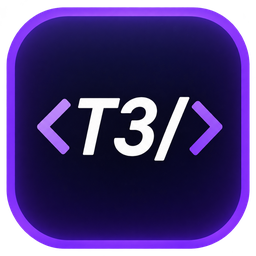

# T3CodeToolkit

> **This project isn't affiliated with the official T3 Code.** It's an unofficial, community add-on for
> [T3 Code](https://t3.codes), not made, endorsed or supported by T3 Tools, Inc.

It targets stable T3 Code releases (tested on 0.1.11).

It adds features to the T3 Code web app (Chrome and Firefox extension) and the desktop app (launcher):

- **Compact button.** Under the Context row in the thread details panel. It runs the same `/compact`
  as the slash command and is disabled whenever upstream would refuse.
- **Image annotation.** Click an attached image to expand it, then click **Annotate** in the bar under
  it. The image fills the editor. Arrow is the default tool; you can also use a pen, boxes or numbered pins (Ctrl+Alt+Left/Right switches tools). Ctrl+scroll, Ctrl+=/− or the zoom buttons zoom into the image (Ctrl+0 fits it again), and a zoomed image scrolls left, right, up and down. A note bubble
  opens beside each new mark so you can say what should change there (Enter or Esc closes it).
  Click a mark's number to reopen its note. Click the send button (or press Ctrl/Cmd+Enter) to add
  it to your message. The marked-up image is attached and the notes are added as text, so the agent
  knows what's wrong where. Press P, A, B or N to pick a tool. Select a mark by its number, then
  press Delete or Backspace (or × in its note) to remove it. Ctrl/Cmd+Z undoes a drawing edit,
  including deleting a mark or clearing the drawing. Ctrl+Y or Ctrl/Cmd+Shift+Z redoes it. In a note,
  those keys edit the text. Esc in the drawing closes the editor.
- **Effort shortcuts.** Alt+1 to Alt+6 (Option+1 to 6 on macOS) pick the reasoning effort of the
  current model, from its lowest level up, the same as choosing it in the model picker. A short message
  confirms the level, or says why there isn't one (for example, a model with only three levels). The picker
  isn't shown while a shortcut changes the level, and the shortcuts also work with the picker open.
  Outside the picker, Ctrl/Cmd+digits still switch threads. While a composer is open, Alt/Option+digits
  take precedence over typing their usual characters (such as ¡ ™ £ on a Mac keyboard).
- **Model switcher.** Ctrl+Alt+1 to Ctrl+Alt+9 (Ctrl+Option on macOS) switch to that favorite model
  without opening the picker, numbered the way **Arrange Favorites** orders them. Hold Ctrl+Alt for a
  moment to see your favorites in a strip above the composer: press 1–9 to pick one, or use the arrow keys
  (or Tab) or the scroll wheel and let go to switch. Ctrl+Alt+scroll also opens the strip straight away
  instead of zooming the window. Letting go without moving changes nothing; Esc cancels. Shift may be held
  too, but on Windows Alt+Shift also switches the input language, so plain Ctrl+Alt is the safer chord.
  AltGr is ignored so it still types its characters.
- **Project switcher.** Ctrl+Shift+1 to Ctrl+Shift+9 open a new thread in that pinned project. Pin
  projects with the pin button in the new-thread project picker; the first pinned project is 1, and later
  pins are added after it. The toolkit keeps that numbering in the current browser or desktop profile, so it
  doesn't move when the app lists the current project first. Hold Ctrl+Shift for a moment to see the projects
  in a strip, pinned ones numbered first: press 1–9, or use the arrow keys (or Tab) or Ctrl+Shift+scroll and
  let go. Letting go without moving changes nothing; Esc cancels. When the message box has text, the arrow
  keys keep selecting words, so use the wheel or a digit there. Any other Ctrl+Shift shortcut closes the
  strip and works as usual. The switcher stays off on the Usage page (Ctrl+Shift+1–4 choose its period) and
  in the terminal (not yet tested there). If the draft already has a message but no project, clear the
  message first. On Windows, Ctrl+Shift on its own can switch the keyboard layout when more than one is installed.
- **Arrange Favorites.** In the model picker, open **Favorites**, then **Arrange Favorites**. Drag a row by
  its grip (⠿), or use the up/down buttons, to move models across providers, then click **Done**.
  While the arranged list shows, Ctrl+1–9 (Cmd on macOS) picks models in that order. The order saves as you move each
  model and is stored per environment in the current browser or desktop profile. Select a numbered row by
  clicking it, pressing 1–9 while the ordered panel has focus, or pressing Ctrl/Cmd+1–9 in the arranged
  picker on desktop. **Original list** brings back the built-in picker view and star controls.
- **Project image gallery.** With the grouped sidebar on (Settings → Labs → Boring sidebar), hover a
  project and click the picture icon beside the new-thread button. It shows every image sent or produced in
  that project's threads, including settled ones: your attachments and images the agent linked in its
  replies. Images returned by tools (such as browser screenshots) are read too, but that path hasn't been
  tested in a live app yet. Newest first by default; sort by oldest, name, size or thread, filter
  by who sent it, or search by name or thread title. Click an image for **Open thread**, **Add to message**,
  **Annotate** or **Open full size**. It only reads; images whose files were deleted are hidden.
- **Toolkit menu.** The **Toolkit** button (hammer icon) at the top right turns each feature on or off.
  A switch applies at once and is saved in the current browser or desktop profile. Its **Privacy**
  section has a telemetry switch for the desktop app started from the toolkit; it applies the next time
  T3 Code starts. On the web, telemetry is set by the server (see [Telemetry](#telemetry)).
- **Telemetry off** where it can be: see [Telemetry](#telemetry).

## Build

```
npm install
npm run build      # dist/t3tk-core.js, copied to extension/core.js
npm run package    # release/T3CodeToolkit-<version>.zip (desktop) and -extension-<version>.zip
npm test           # unit tests (Node's built-in runner; run after `npm run package`)
```

GitHub Actions (`.github/workflows/ci.yml`) runs the build, the package and the tests on Windows,
macOS and Linux for every push and pull request, and keeps the release zips from the Linux run as a
download. The tests install the desktop toolkit into a temporary folder with a stand-in app, so they
check the installer on all three systems but don't start T3 Code itself.

## Browser extension (web app and T3 Connect)

**Chrome / Edge:** open `chrome://extensions`, turn on Developer mode, click **Load unpacked** and pick the
`extension` folder.

**Firefox (128+):** open `about:debugging#/runtime/this-firefox`, click **Load Temporary Add-on** and pick
`extension/manifest.json`. Then in `about:addons` → T3CodeToolkit → Permissions, allow access to
`app.t3.codes` (Firefox doesn't grant host permissions on install).

It runs on `https://app.t3.codes` by default, which is also where remote sessions (T3 Connect) open. To use it
with a local `t3` server or another host, click the toolbar icon and add that address; the browser asks for
permission for just that site.

## Desktop app

Install once, then start T3 Code from the new **T3 Code + Toolkit** shortcut. Unzip
`T3CodeToolkit-<version>.zip` (or use this folder after `npm run build`) and run:

| OS | Install | Shortcut created |
| --- | --- | --- |
| Windows | double-click `install.cmd` | Start Menu → T3 Code + Toolkit |
| macOS | double-click `install.command` | ~/Applications/T3 Code + Toolkit.app |
| Linux | `./install.sh` | applications menu (T3 Code + Toolkit) |

The installer runs on T3 Code's own binary, so neither Node nor npm is needed. It copies the toolkit to
`%LOCALAPPDATA%\T3CodeToolkit` (Windows), `~/Library/Application Support/T3CodeToolkit` (macOS) or
`~/.local/share/t3codetoolkit` (Linux). Options: `--keep-telemetry`, `--app <path to the T3 Code
executable or AppImage>` if it isn't found, `--no-shortcuts`, and `--uninstall` to remove everything again.

The shortcut starts your installed T3 Code and injects the toolkit. Nothing in the T3 Code install is
changed, so it keeps working after T3 Code updates. Good to know:

- **Quit T3 Code first.** The app allows one copy; if it's already running, the shortcut tells you so.
- **Launch screen.** The toolkit shortcut shows the purple toolkit logo on the T3 Code startup screen.
- **Windows taskbar.** Pin **T3 Code + Toolkit** from the Start menu. If you have a **T3 Code (Beta)**
  pin, unpin it first. The toolkit shortcut and its running window share their own taskbar identity.
- **The connection is private.** The toolkit talks to the window over a DevTools pipe that only its own
  launcher holds (`--remote-debugging-pipe`), not a network port, so no other program can attach.
  The launcher runs hidden while T3 Code is open and exits with it. Logs: `launcher.log` and
  `launcher-output.log` in the install folder.
- **Restarts.** When T3 Code restarts itself (some settings changes, installing an update), the new
  window is expected to run without the toolkit. Quit it and open the shortcut again.
- **macOS:** permission prompts (microphone, folders) may name the toolkit launcher instead of T3 Code.
- **Tested on Windows only so far.** The macOS and Linux installers haven't been run yet; please report
  what happens.

Without installing: `npm run desktop -- [--app <path>] [--keep-telemetry]`.

## Telemetry

T3 Code's analytics are sent by its **server**, not the page, so:

- **Desktop:** the launcher starts the app with `T3CODE_TELEMETRY_ENABLED=false`. To make it permanent, even
  when you start T3 Code normally, run `scripts\telemetry.cmd off` (Windows) or `scripts/telemetry.sh off`
  (macOS/Linux), then restart T3 Code. Use `on` to undo. The **Toolkit** menu's telemetry switch changes
  the launcher's own setting (the same as installing with `--keep-telemetry`); it can't override the
  permanent user setting from those scripts.
- **Self-hosted `t3`:** set `T3CODE_TELEMETRY_ENABLED=false` where the server runs.
- **Hosted app.t3.codes:** the extension can't turn it off. That's up to the service.

## Troubleshooting

In the page's DevTools console, `__t3tk.health()` shows each feature as `ok`, `idle` (nothing to attach to
right now) or `broken` (an upstream change; please report it). `__t3tk.stop()` removes the toolkit until
reload.

## Contributing

Contributions are welcome: open an issue for bugs (include `__t3tk.health()` output) or a pull request
for fixes and features. Please run `npm test` before sending a PR. Forks are fine too, under the license.

## License and trademarks

MIT, see [LICENSE](LICENSE). Copyright (c) 2026 PonkoKobo.

This project isn't affiliated with, endorsed by or sponsored by T3 Tools, Inc. or the official T3 Code
project. T3 Code and the T3 logo are trademarks of T3 Tools, Inc. The T3 Code name is used only to say
what this add-on works with, following T3 Code's trademark guidelines; the T3 logo isn't used. If
T3 Tools asks, the project will be renamed.
