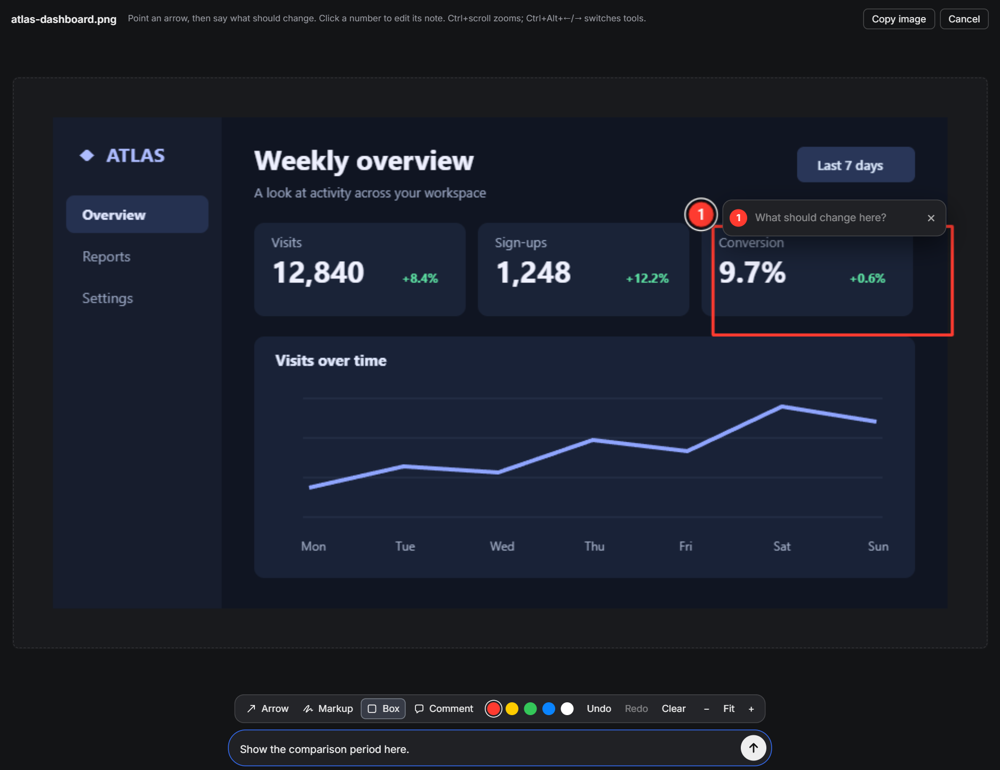
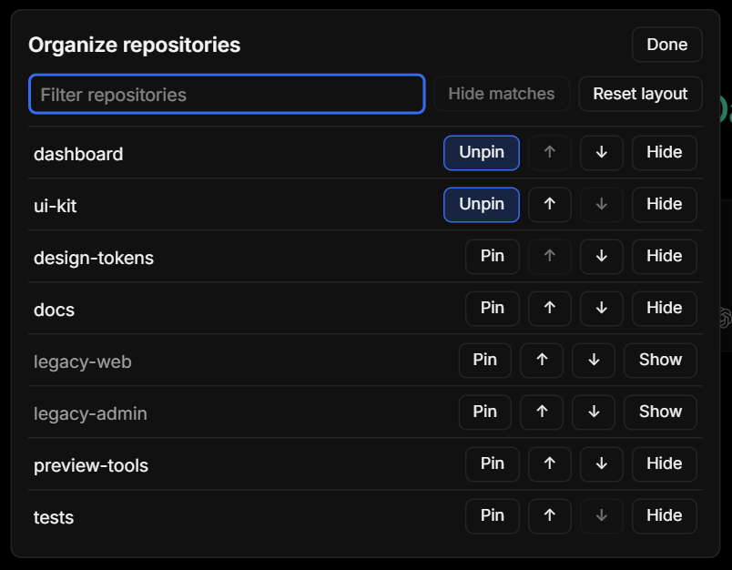
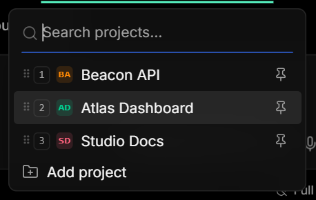
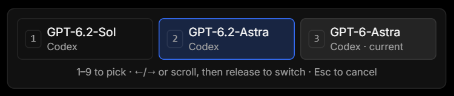
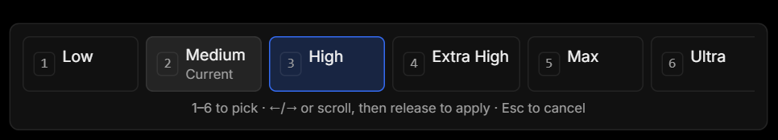
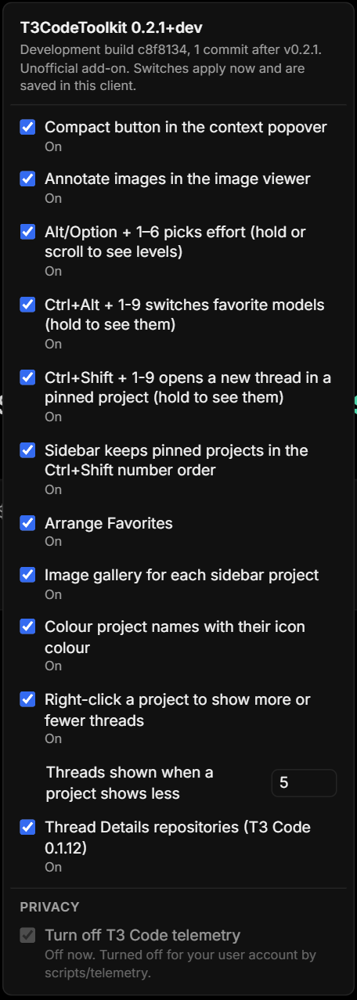

# T3CodeToolkit

> **This project isn't affiliated with the official T3 Code.** It's an unofficial, community add-on for
> [T3 Code](https://t3.codes), not made, endorsed or supported by T3 Tools, Inc.

Desktop support includes T3 Code 0.1.12 and 0.1.13. After an unrecognized desktop update,
T3 Code opens with Toolkit features paused. Choose **Continue with features paused** or
**Try my features** for the current window session. Both choices preserve your saved switches.
A popup confirms when features are disabled, and the title-bar button reads **Toolkit disabled**.
Version-specific fixes stay off until the desktop release has been checked.

## Install

Download the ZIP for your setup from [GitHub Releases](https://github.com/PonkoKobo/t3codetoolkit/releases).

- **Desktop:** Choose `T3CodeToolkit-<version>.zip`. It includes the installer for Windows, macOS and
  Linux and uses your existing T3 Code installation. [Desktop setup](#desktop-app)
- **Chrome** — `T3CodeToolkit-extension-chrome-<version>.zip`
- **Microsoft Edge** — `T3CodeToolkit-extension-edge-<version>.zip`
- **Firefox** — `T3CodeToolkit-extension-firefox-<version>.zip`

See [Browser setup](#browser-extension-web-app-and-t3-connect) for installation steps.

## Screenshots

Captured in T3 Code 0.1.12 with sample projects. Open any screenshot for the full-size image.

### Image annotation

Draw directly on an attachment and add notes before sending it back to the agent.

[](assets/screenshots/image-annotation.png)

### Repository organizer

Pin and reorder repositories in Thread Details. Hidden repositories can be restored from the same panel.

<a href="assets/screenshots/repository-organizer.png"></a>

<details>
<summary>Project pins, keyboard switchers, and the Toolkit menu</summary>

**Project pins** assign numbers for Ctrl+Shift+1–9 and control pinned project order.

<a href="assets/screenshots/project-pinning.png"></a>

**Favorite models** appear above the composer when you hold Ctrl+Alt (Ctrl+Option on macOS).

<a href="assets/screenshots/model-switcher.png"></a>

**Reasoning effort** can be selected in the carousel by holding Alt or Option.

<a href="assets/screenshots/effort-switcher.png"></a>

**Toolkit menu** lists the available features and their switches.

<a href="assets/screenshots/toolkit-menu.png"></a>

</details>

## Features

It adds features to the T3 Code web app (Chrome and Firefox extension) and the desktop app (launcher):

- **Compact button.** In Thread Details under Context, click **Compact** or press **Shift+C** outside
  text fields and the terminal. Both run the same `/compact` action when it is available.
- **Image annotation.** Click an attached image to expand it, then press **Shift+A** or click
  **Annotate** below the image. The image fills the editor. Arrow is the default tool; you can also use a pen, boxes or numbered pins (Ctrl+Alt+Left/Right switches tools). Ctrl+scroll, Ctrl+=/− or the zoom buttons zoom into the image (Ctrl+0 fits it again), and a zoomed image scrolls left, right, up and down. A note bubble
  opens beside each new mark so you can say what should change there (Enter or Esc closes it).
  Click a mark's number to reopen its note. Click the send button (or press Ctrl/Cmd+Enter) to add
  it to your message. The marked-up image is attached and the notes are added as text, so the agent
  knows what's wrong where. Press P, A, B or N to pick a tool. Select a mark by its number, then
  press Delete or Backspace (or × in its note) to remove it. Ctrl/Cmd+Z undoes a drawing edit,
  including deleting a mark or clearing the drawing. Ctrl+Y or Ctrl/Cmd+Shift+Z redoes it. In a note,
  those keys edit the text. Esc in the drawing closes the editor.
- **Effort shortcuts.** Alt+1 to Alt+6 (Option+1 to 6 on macOS) pick the reasoning effort of the
  current model, from its lowest level up. Hold Alt/Option to see those levels in a carousel, or use
  Alt/Option+scroll to open it immediately. Scroll up for higher effort and down for lower, or use
  Left/Right. Release Alt/Option to apply the highlighted change. Press Esc to cancel. A short message
  confirms the level or explains why it is unavailable. The model picker
  isn't shown while a shortcut changes the level, and the shortcuts also work with the picker open.
  Outside the picker, Ctrl/Cmd+digits still switch threads. While a composer is open, Alt/Option+digits
  take precedence over typing their usual characters (such as ¡ ™ £ on a Mac keyboard).
- **Model switcher.** Ctrl+Alt+1 to Ctrl+Alt+9 (Ctrl+Option on macOS) switch to that favorite model
  without opening the picker, numbered the way **Arrange Favorites** orders them. Hold Ctrl+Alt for a
  moment to see your favorites in a strip above the composer: press 1–9 to pick one, or use the arrow keys
  (or Tab) or the scroll wheel and let go to switch. Ctrl+Alt+scroll also opens the strip straight away
  instead of zooming the window. Letting go without moving changes nothing; Esc cancels. Shift may be held
  too, but on Windows Alt+Shift also switches the input language, so plain Ctrl+Alt is the safer chord.
  AltGr is ignored so it still types its characters.
- **Project switcher.** Ctrl+Shift+1 to Ctrl+Shift+9 open a new thread in that pinned project. Pin
  projects with the pin button in the new-thread project picker; the first pinned project is 1, and later
  pins are added after it. The toolkit keeps that numbering in the current browser or desktop profile, so it
  doesn't move when the app lists the current project first. In the project picker, pinned projects are
  listed first with their number (1–9); drag a number's grip (⠿) to change the order. Hold Ctrl+Shift for a moment to see the projects
  in a strip, pinned ones numbered first: press 1–9, or use the arrow keys (or Tab) or Ctrl+Shift+scroll and
  let go. Letting go without moving changes nothing; Esc cancels. When the message box has text, the arrow
  keys keep selecting words, so use the wheel or a digit there. Any other Ctrl+Shift shortcut closes the
  strip and works as usual. The switcher stays off on the Usage page (Ctrl+Shift+1–4 choose its period) and
  in the terminal (not yet tested there). If the draft already has a message but no project, clear the
  message first. On Windows, Ctrl+Shift on its own can switch the keyboard layout when more than one is installed.
- **Sidebar project order.** Pinned projects in the sidebar follow the same order as the Ctrl+Shift
  numbers, with the number after each name, instead of moving with thread activity. Change the order by
  dragging in the project picker. Unpinned projects keep T3 Code's own order; choose **Manual** project
  sorting in T3 Code's settings to stop those moving too. Rows are reordered on screen only, so arrow-key
  navigation in the sidebar still follows T3 Code's order.
- **Project name colors.** Project names in the sidebar and new-thread heading use the color of the
  project icon when it has one.
- **Arrange Favorites.** In the model picker, open **Favorites**, then **Arrange Favorites**. Drag a row by
  its grip (⠿), or use the up/down buttons, to move models across providers, then click **Done**.
  While the arranged list shows, Ctrl+1–9 (Cmd on macOS) picks models in that order. The order saves as you move each
  model and is stored per environment in the current browser or desktop profile. Select a numbered row by
  clicking it, pressing 1–9 while the ordered panel has focus, or pressing Ctrl/Cmd+1–9 in the arranged
  picker on desktop. **Original list** brings back the built-in picker view and star controls.
- **Project image gallery.** With the grouped sidebar on (Settings → Labs → Boring sidebar), hover a
  project and click the picture icon beside the new-thread button. It shows every image sent or produced in
  that project's threads, including settled ones: your attachments and images the agent linked in its
  replies. Images returned by tools (such as browser screenshots) are read too, but that path hasn't been
  tested in a live app yet. Newest first by default; sort by oldest, name, size or thread, filter
  by who sent it, or search by name or thread title. Click an image for **Open thread**, **Add to message**,
  **Annotate** or **Open full size**. It only reads; images whose files were deleted are hidden.
- **Show more or fewer threads.** Right-click a project in the sidebar. **Show less** lists only its first
  few threads (5 by default) and **Show more** lists them all again; on a collapsed project **Show more**
  expands it. Set how many threads stay in the Toolkit menu, under this feature's switch. The open
  thread always stays visible. The choice is kept per project in the current browser or desktop profile.
- **Toolkit menu.** The **Toolkit** button (hammer icon) at the top right turns each feature on or off.
  A switch applies at once and is saved in the current browser or desktop profile. Its **Privacy**
  section has a telemetry switch for the desktop app started from the toolkit; it applies the next time
  T3 Code starts. On the web, telemetry is set by the server (see [Telemetry](#telemetry)).
- **Telemetry off** where it can be: see [Telemetry](#telemetry).
- **Thread Details repository expansion (desktop 0.1.12).** **Show more** keeps the extra
  repositories in the scrollable card. The fix is on by default for 0.1.12
  and has its own switch in the Toolkit menu. [T3 Code issue #42907](https://github.com/pingdotgg/t3code/issues/42907)
- **Organize repositories (desktop 0.1.12 and 0.1.13).** In Thread Details, pin rows to the top, move them
  up or down, or hide them from the list. Filter by name to **Hide matches**, or open the organizer
  to show hidden rows again. The layout is shared by threads in the same project folder and saved
  in the current desktop profile.

## Browser extension (web app and T3 Connect)

**Chrome / Edge** — Extract the ZIP for your browser. Open `chrome://extensions` or `edge://extensions`,
turn on Developer mode, click **Load unpacked** and pick the folder containing `manifest.json`
(`extension` if building from source).

**Firefox (128+)** — Open `about:debugging#/runtime/this-firefox`, click **Load Temporary Add-on** and
select the Firefox ZIP directly, or pick `manifest.json` if you already extracted it. Then in
`about:addons` → T3CodeToolkit → Permissions, allow access to `app.t3.codes` if prompted. Repeat the
temporary load after each Firefox restart. Permanent installation requires a signed Firefox add-on.

For Chrome or Edge updates, replace the files in the same unpacked folder and click **Reload** on the
extension card. Refresh any open T3 Code tabs. In Firefox, remove the temporary add-on and load the new ZIP.

It runs on `https://app.t3.codes` by default, which is also where remote sessions (T3 Connect) open. To use it
with a local `t3` server or another host, click the toolbar icon and add that address; the browser asks for
permission for just that site.

## Desktop app

Install [T3 Code](https://t3.codes) first. Extract the desktop ZIP and run the installer for your OS.

| OS | Install | Shortcut created |
| --- | --- | --- |
| Windows | double-click `install.cmd` | Start Menu → T3 Code + Toolkit |
| macOS | double-click `install.command` | ~/Applications/T3 Code + Toolkit.app |
| Linux | `./install.sh` | applications menu (T3 Code + Toolkit) |

The installer runs on T3 Code's own binary, so neither Node nor npm is needed. It copies the toolkit to
`%LOCALAPPDATA%\T3CodeToolkit` (Windows), `~/Library/Application Support/T3CodeToolkit` (macOS) or
`~/.local/share/t3codetoolkit` (Linux). The installer accepts `--keep-telemetry`, `--no-shortcuts` and
`--uninstall`. If it can't find T3 Code, set `T3TK_APP` to the full path to its executable or AppImage
before running the installer.

After installing, open **T3 Code + Toolkit**. To update, quit T3 Code, extract the new desktop ZIP and
run its installer again. The shortcut and your toolkit preferences carry over.

The shortcut starts your installed T3 Code and injects the toolkit. Nothing in the T3 Code install is
changed, so it keeps working after T3 Code updates. Good to know:

- **Quit T3 Code first.** The app allows one copy; if it's already running, the shortcut tells you so.
- **Launch screen.** The toolkit shortcut shows the purple toolkit logo on the T3 Code startup screen.
- **Windows taskbar.** Pin **T3 Code + Toolkit** from the Start menu. If you have a **T3 Code (Beta)**
  pin, unpin it first. The toolkit shortcut and its running window share their own taskbar identity.
- **The connection is private.** The toolkit talks to the window over a DevTools pipe that only its own
  launcher holds (`--remote-debugging-pipe`), not a network port, so no other program can attach.
  The launcher runs hidden while T3 Code is open and exits with it. Logs: `launcher.log` and
  `launcher-output.log` in the install folder.
- **Restarts.** When T3 Code restarts itself (some settings changes, installing an update), the new
  window is expected to run without the toolkit. Quit it and open the shortcut again.
- **macOS:** permission prompts (microphone, folders) may name the toolkit launcher instead of T3 Code.
- **Compatibility:** CI checks installation on Windows, macOS and Linux with a stand-in app. Live T3 Code
  use has been tested on Windows.

Without installing: `npm run desktop -- [--app <path>] [--keep-telemetry]`.

## Telemetry

T3 Code's analytics are sent by its **server**, not the page, so:

- **Desktop:** the launcher starts the app with `T3CODE_TELEMETRY_ENABLED=false`. To make it permanent, even
  when you start T3 Code normally, run `scripts\telemetry.cmd off` (Windows) or `scripts/telemetry.sh off`
  (macOS/Linux), then restart T3 Code. Use `on` to undo. The **Toolkit** menu's telemetry switch changes
  the launcher's own setting (the same as installing with `--keep-telemetry`); it can't override the
  permanent user setting from those scripts.
- **Self-hosted `t3`:** set `T3CODE_TELEMETRY_ENABLED=false` where the server runs.
- **Hosted app.t3.codes:** the extension can't turn it off. That's up to the service.

## Troubleshooting

In the page's DevTools console, `__t3tk.health()` shows each feature as `ok`, `idle` (nothing to attach to
right now) or `broken` (an upstream change; please report it). `__t3tk.stop()` removes the toolkit until
reload.

## Contributing

Contributions are welcome: open an issue for bugs (include `__t3tk.health()` output) or a pull request
for fixes and features. Please build the packages and run the tests before sending a PR.

## Build and release

```sh
npm ci
npm run package
npm test
```

Use Node.js 22.2 or later. The package command builds the desktop, Chrome, Edge and Firefox ZIPs and
`SHA256SUMS.txt` in `release/`.
CI runs packaging and tests on Windows, macOS and Linux and keeps the Linux downloads as a build artifact.

The toolkit uses `MAJOR.MINOR.PATCH` versions independent of T3 Code's version. Use a patch bump for fixes,
a minor bump for new features, and a major bump for breaking changes after 1.0. During 0.x, document breaking
changes in the notes and bump the minor version. The browser manifest requires a numeric version.

**Every version bump must ship with a published GitHub Release for the same version.** Push the
version commit and its matching annotated tag together, then verify the release is live.

1. Run `npm run release:version -- patch` (or `minor` or `major`) to update the package, lockfile and
   extension manifest together. The bundle takes its displayed version from `package.json` at build time.
   A build of anything other than the clean, tagged release commit shows `+dev` after the version and,
   under it, the commit and the release it follows, so only the published build shows the bare number.
   For the first release of an already-set version, skip the bump.
2. Run the package command and tests, then commit the changes at the tip of the default branch.
3. Tag that commit with the version from `package.json` and a short note about what changed for users.
   For example, run `git tag -a v0.2.2 -m "Fix model switching when the picker is open."`, then
   `git push --atomic origin main v0.2.2`. CI checks that a version bump on the default branch has its
   matching annotated tag on the pushed commit.
4. When the tagged build passes CI on Windows, macOS and Linux, GitHub Actions publishes all four
   ZIPs, checksums, install steps and the tag message's first line under **What's new**. Check that
   the new version and its downloads appear on [GitHub Releases](https://github.com/PonkoKobo/t3codetoolkit/releases).

## License and trademarks

MIT, see [LICENSE](LICENSE). Copyright (c) 2026 PonkoKobo.

This project isn't affiliated with, endorsed by or sponsored by T3 Tools, Inc. or the official T3 Code
project. T3 Code and the T3 logo are trademarks of T3 Tools, Inc. The T3 Code name is used only to say
what this add-on works with, following T3 Code's trademark guidelines; the T3 logo isn't used. 
